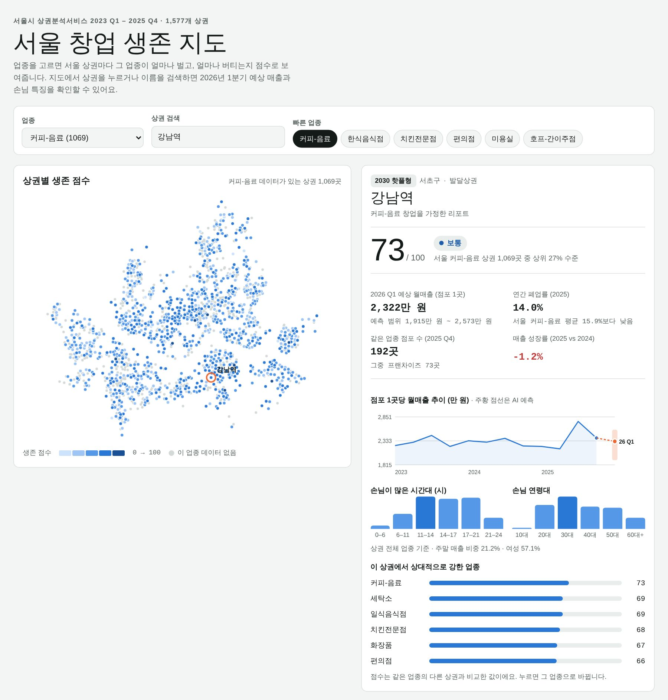

# 서울 창업 생존 지도

> 여기서 카페 차리면 버틸까? 서울 1,577개 상권의 매출·폐업 데이터로 창업 생존 점수와 다음 분기 매출을 예측하고, 웹 지도로 보여주는 프로젝트

## 결과물

| 구분 | 파일 | 내용 |
|---|---|---|
| ① 데이터 분석·AI 모델링 | [`seoul_startup_survival.ipynb`](seoul_startup_survival.ipynb) | 업종·상권별 매출/폐업 분석, K-Means 상권 성격 군집화, Gradient Boosting 매출 예측, 창업 생존 점수 |
| ② AI 서비스 구현 | `index.html` | 업종을 고르면 상권별 생존 점수 지도, 상권 리포트(예상 매출·폐업률·손님 특징), 추천 상권 순위를 보여주는 웹서비스 |

**👉 웹서비스 바로 열기: https://fafa0215.github.io/seoul-startup-survival-map/**

`index.html`을 내려받아 브라우저로 열어도 바로 실행됩니다(데이터 내장, 서버 불필요).

## 주요 결과

- 음식·음료 업종은 폐업률이 가장 높은 그룹이며, 카페(커피-음료)는 연간 폐업률 15.9%로 최상위권
- 같은 카페라도 상권에 따라 점포당 매출이 상·하위 10% 사이 약 15배 차이
- 손님 구성(시간대·연령·주말)으로 서울 상권을 5가지 성격으로 분류: 2030 핫플형, 심야·유흥형, 40대 학원가·아파트형, 5060 시장·생활형, 복합 생활형
- 다음 분기 점포당 매출 예측 R² 0.91 (단순 기준선 0.88)
- 2024년 기준 생존 점수 상위 20% 상권의 이듬해 폐업률 8.8%, 하위 20%는 11.5%

## 데이터 (서울 열린데이터광장, 공공누리 1유형)

- [서울시 상권분석서비스(추정매출-상권)](https://data.seoul.go.kr/dataList/OA-15572/S/1/datasetView.do) 2023~2025
- [서울시 상권분석서비스(점포-상권)](https://data.seoul.go.kr/dataList/OA-15577/S/1/datasetView.do) 2023~2025
- [서울시 상권분석서비스(영역-상권)](https://data.seoul.go.kr/dataList/OA-15560/S/1/datasetView.do)

원본 zip 파일 7개가 이 저장소의 `data/` 폴더에 들어 있습니다. 노트북을 다시 실행하려면 `pip install pandas numpy matplotlib scikit-learn pyshp pyproj` 후 위에서부터 실행합니다.

## 한계

매출은 카드 결제 기반 추정치이며 임대료·인건비는 반영되지 않았습니다. 창업 결정의 참고 자료로만 활용해 주세요.

## 사용 기술

Python (pandas, scikit-learn, matplotlib), HTML · CSS · JavaScript
